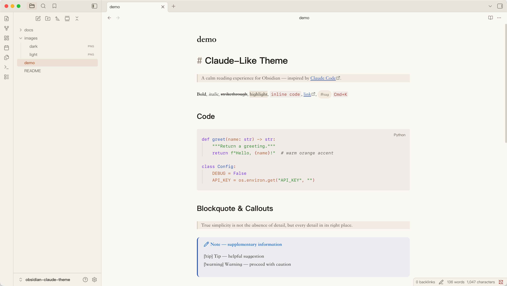
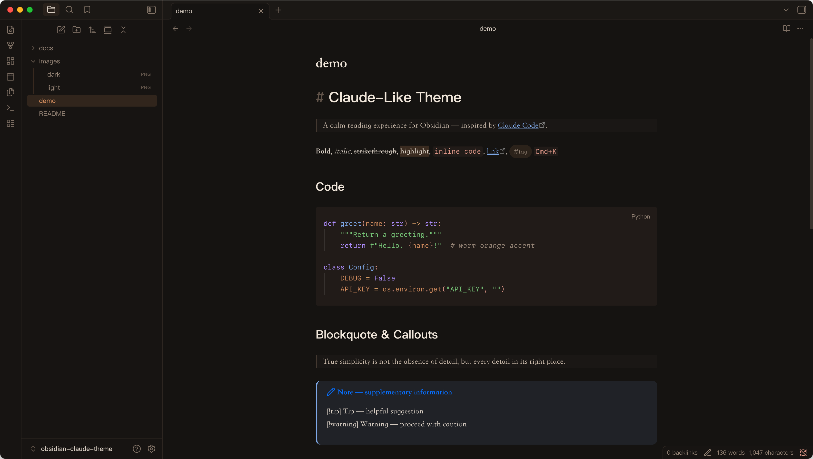

# Tema de Obsidian estilo Claude

Un tema para Obsidian inspirado en la estética visual de [Claude Code](https://claude.ai/code): fondos de un blanco cálido, acentos en naranja terracota y una experiencia de lectura tranquila tanto en modo claro como en modo oscuro.






## Instalación

### Con Claude Code

```
Install this Obsidian theme for me: https://github.com/Ziy1-Tan/obsidian-claude-theme
```

### Manual

1. Descarga `theme.css` y `manifest.json` de este repositorio
2. En Obsidian, ve a **Configuración → Apariencia → Abrir carpeta de temas**
3. Crea una nueva carpeta llamada `Claude-Like` y coloca ambos archivos dentro
4. Ve a **Configuración → Apariencia → Temas** y selecciona **Claude-Like**


## Inspiración y reconocimientos

- **[Claude Code](https://claude.ai/code)** de [Anthropic](https://anthropic.com) — el fondo blanco cálido `#faf9f5`, el acento en naranja quemado `#bc6a3a` y el lenguaje de diseño visual
- **[Typora Claude-Like Theme](https://github.com/Muyiiiii/Typora_Claude-Like_Theme)** de [Muyiiiii](https://github.com/Muyiiiii) — los tokens de color de este tema están adaptados directamente de dicho trabajo

El objetivo es llevar la atmósfera de lectura de Claude Code a Obsidian: neutros cálidos, contraste suave y resaltado de sintaxis que no compita por la atención.


## Recomendaciones de fuentes

Funciona con las fuentes del sistema de forma predeterminada. Para la mejor experiencia:

| Propósito | Fuente |
|---------|------|
| Texto principal en chino | [Noto Serif CJK SC](https://fonts.google.com/noto/specimen/Noto+Serif+SC) |
| Monoespaciada / código | [Cascadia Code](https://github.com/microsoft/cascadia-code) · [SF Mono](https://developer.apple.com/fonts/) |


## Licencia

MIT
