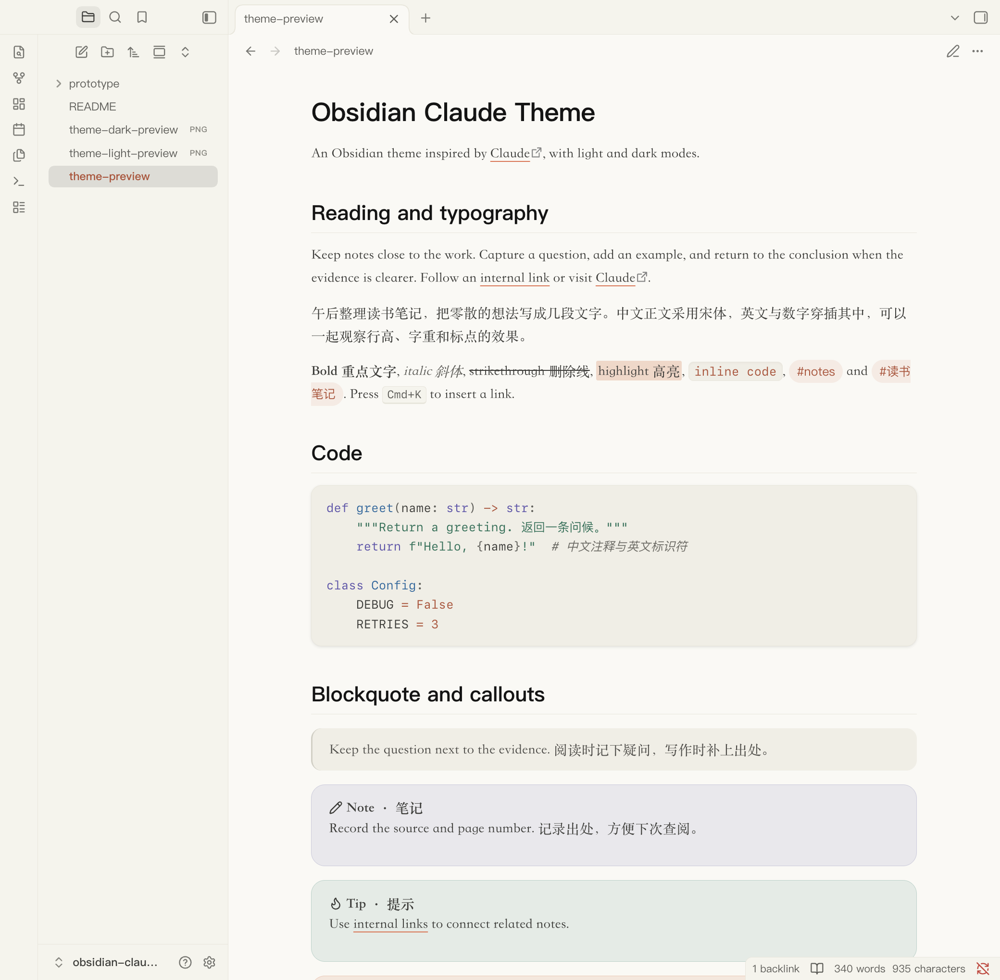
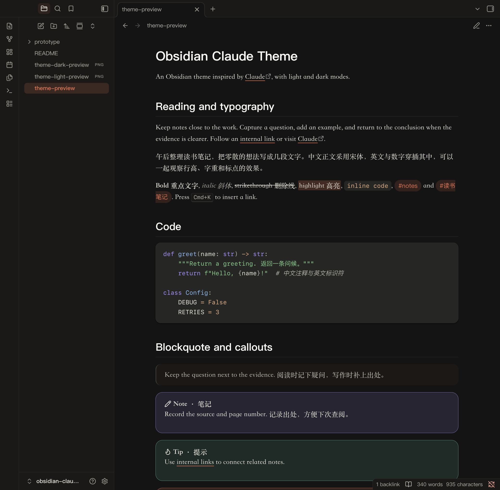

# Obsidian Claude Theme

An Obsidian theme based on the look of [Claude](https://claude.com/product/overview). Supports light and dark mode.





## Installation

### With Claude Code

```
Install this Obsidian theme for me: https://github.com/Ziy1-Tan/obsidian-claude-theme
```

### Manual

1. In Obsidian, go to **Settings → Appearance → Open themes folder**
2. Create a new folder named `Obsidian Claude Theme`
3. Download `theme.css` and `manifest.json` from this repository into that folder
4. Go to **Settings → Appearance → Themes** and select **Obsidian Claude Theme**

```sh
theme_dir="/path/to/your/vault/.obsidian/themes/Obsidian Claude Theme"
mkdir -p "$theme_dir"
curl -fL https://raw.githubusercontent.com/Ziy1-Tan/obsidian-claude-theme/main/theme.css -o "$theme_dir/theme.css"
curl -fL https://raw.githubusercontent.com/Ziy1-Tan/obsidian-claude-theme/main/manifest.json -o "$theme_dir/manifest.json"
```

## Acknowledgements

- [Claude](https://claude.com/product/overview) by [Anthropic](https://anthropic.com): the `#faf9f5` background, `#c6613f` accent, and overall design
- [Typora Claude-Like Theme](https://github.com/Muyiiiii/Typora_Claude-Like_Theme) by [Muyiiiii](https://github.com/Muyiiiii): the color tokens are adapted from this theme

## Fonts

System fonts work out of the box. Optional recommendations:

| Purpose | Font |
|---------|------|
| Chinese body text | [Noto Serif CJK SC](https://fonts.google.com/noto/specimen/Noto+Serif+SC) |
| Monospace / code | [Cascadia Code](https://github.com/microsoft/cascadia-code) · [SF Mono](https://developer.apple.com/fonts/) |

## License

MIT
